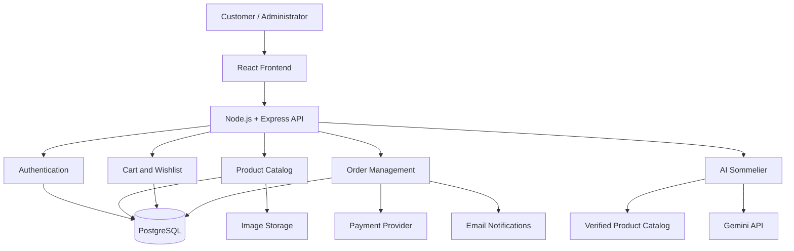

# 🍰 Mithra Sweets & Bakery

### Tradition in Every Bite. Excellence in Every Experience.

**A premium digital destination for Indian sweets, artisan cakes, fresh bakery products, festive hampers, and personalized celebrations.**

<div align="center">

[🌐 Live Demo](#) · [💻 GitHub](https://github.com/Mugunthandk) · [👨‍💻 LinkedIn](https://www.linkedin.com/in/mugunthandk/)


</div>

---

## 📖 Table of Contents

- [Overview](#-overview)
- [Vision and Objectives](#-vision-and-objectives)
- [Features](#-features)
- [AI Sommelier](#-ai-sommelier)
- [Product Categories](#-product-categories)
- [Technology Stack](#-technology-stack)
- [System Architecture](#-system-architecture)
- [Project Structure](#-project-structure)
- [Getting Started](#-getting-started)
- [Environment Variables](#-environment-variables)
- [API Architecture](#-api-architecture)
- [Database Design](#-database-design)
- [Security and Reliability](#-security-and-reliability)
- [Testing](#-testing)
- [Deployment](#-deployment)
- [Development Roadmap](#-development-roadmap)
- [Contributing](#-contributing)
- [Developer](#-developer)
- [License](#-license)

---

## 🌟 Overview

**Mithra Sweets & Bakery** is a modern e-commerce concept that brings the richness of Indian sweets and bakery traditions into a premium digital shopping experience.

The platform is designed to help customers discover traditional mithai, celebration cakes, fresh bakery products, beverages, personalized gift boxes, and seasonal collections through an elegant and convenient interface.

By combining premium product presentation, intuitive shopping workflows, and AI-assisted product discovery, Mithra aims to make everyday treats and special celebrations easier to plan.

### 🎯 Project Objectives

- Create a premium, responsive online sweets and bakery store.
- Showcase products through rich imagery and detailed product information.
- Simplify product discovery with categories, search, and filtering.
- Support personalized cakes, gift boxes, and celebration packages.
- Provide a convenient cart, checkout, and order management experience.
- Introduce an AI Sommelier for personalized product recommendations.
- Establish a scalable architecture for inventory, delivery, payments, and administration.

---

## ✨ Features

### 🛍️ 1. Premium Product Discovery

- Curated product collections.
- Categorized sweets and bakery products.
- Product detail pages and image galleries.
- Product variants, sizes, and quantities.
- Search, sorting, and category filtering.
- Featured products and best sellers.
- Seasonal and festival collections.
- New arrivals and special offers.
- Related product recommendations.
- Product ratings and customer reviews.

### 🍬 2. Traditional Indian Sweets

Explore a curated selection of traditional and contemporary Indian sweets.

Potential categories include:

- Kaju Katli.
- Mysore Pak.
- Laddu varieties.
- Gulab Jamun.
- Rasgulla.
- Jangiri.
- Halwa varieties.
- Milk sweets.
- Regional specialties.
- Assorted mithai gift boxes.

Product availability, ingredients, and regional specialties should be configured according to the actual business catalog.

### 🎂 3. Premium Cakes and Celebrations

- Birthday cakes.
- Wedding cakes.
- Anniversary cakes.
- Chocolate cakes.
- Designer cakes.
- Custom photo cakes.
- Eggless cake options.
- Celebration packages.
- Cake message personalization.
- Size and flavor selection.
- Scheduled delivery requests.

Custom orders can capture design references, flavor preferences, serving size, delivery date, and customer instructions.

### 🥐 4. Bakery and Beverages

**Bakery collection**

- Bread and buns.
- Cookies and biscuits.
- Puffs and savory snacks.
- Pastries.
- Muffins.
- Croissants and baked treats.

**Beverage collection**

- Coffee.
- Tea.
- Traditional Indian drinks.
- Seasonal beverages.
- Milk-based drinks.

### 🎁 5. Gifts and Festival Collections

- Premium sweet boxes.
- Corporate gifting.
- Wedding return gifts.
- Birthday gift hampers.
- Diwali collections.
- Pongal specials.
- Christmas collections.
- Regional festival assortments.
- Personalized gift messages.
- Bulk gifting inquiries.

### 🛒 6. Smart Shopping Bag

- Add and remove products.
- Update quantities.
- Select product variants.
- Calculate subtotals.
- Apply eligible coupon codes.
- Display delivery charges and applicable taxes.
- Preserve cart state between visits.
- Validate stock and pricing before checkout.

### 💳 7. Checkout and Payments

Planned capabilities include:

- Customer details and delivery addresses.
- Delivery slot selection.
- Scheduled cake delivery.
- Order summary and pricing breakdown.
- Coupon validation.
- Online payment integration.
- Cash on delivery where supported.
- Order confirmation.
- Payment status tracking.

Payment methods must only be displayed when the corresponding payment provider or ordering workflow is configured.

### 🚚 8. Delivery and Order Management

- Order confirmation notifications.
- Order history.
- Order status timeline.
- Delivery instructions.
- Scheduled delivery requests.
- Order cancellation according to business rules.
- WhatsApp-assisted customer communication.
- Delivery status management.

Real-time tracking requires a connected delivery or logistics integration. Otherwise, display the actual order status provided by the business.

### 🤖 9. AI Sommelier

A planned AI-powered product discovery assistant that helps customers choose sweets, cakes, and gifts based on preferences, budget, ingredients, and occasions.

Possible features:

- Personalized sweet recommendations.
- Gift selection by budget.
- Festival and occasion-based suggestions.
- Cake flavor and size guidance.
- Recommendations for assorted gift boxes.
- Conversational product discovery.
- Ingredient and allergen information retrieved from verified product records.

### 👤 10. Customer Accounts

- Customer registration and login.
- Profile management.
- Saved delivery addresses.
- Wishlist.
- Order history.
- Saved preferences.
- Reordering previous purchases.
- Account security and session management.

### ⚙️ 11. Admin Dashboard

Planned administration features:

- Product and category management.
- Product image uploads.
- Price and variant management.
- Inventory management.
- Stock availability alerts.
- Custom cake request management.
- Festival collection management.
- Order processing.
- Coupon and promotion management.
- Customer inquiries.
- Sales and order analytics.
- Delivery status updates.

### 📱 12. Responsive User Experience

- Mobile-first layouts.
- Tablet and desktop compatibility.
- Responsive navigation.
- Optimized product images.
- Smooth transitions and micro-interactions.
- Accessible forms and controls.
- Loading skeletons and empty states.
- Clear error messages.
- Light and dark themes where appropriate.

---

## 🤖 AI Sommelier: Personalized Product Discovery

The AI Sommelier is intended to make product selection more intuitive and personal.

### Example interaction

**Customer:**

"Suggest a premium sweet box under ₹1,000 for a family celebration. We prefer traditional sweets and want a gift-ready package."

**Potential assistant response:**

- Matching gift boxes from the actual product catalog.
- Current prices and package sizes.
- Available ingredients and allergen information.
- Recommendations based on the occasion and budget.
- Product links for further exploration.
- An option to add an available product to the shopping bag.

### Proposed AI workflow

1. Collect the customer's budget, preferences, and occasion.
2. Retrieve suitable products from the verified catalog.
3. Send relevant product information to the AI service.
4. Generate recommendations with clear explanations.
5. Validate the returned product identifiers.
6. Display verified product details and current prices.
7. Allow the customer to view or add selected products.

### AI safety and reliability

- Keep API credentials on the backend.
- Ground recommendations in actual catalog records.
- Never invent product prices, stock levels, or ingredients.
- Retrieve allergen information from verified business records.
- Do not claim a product is safe for an allergy unless the information has been verified.
- Provide a standard search fallback when AI is unavailable.

AI features should be marked as planned until the integration is implemented and tested.

---

## 🛠️ Technology Stack

### Frontend

| Technology | Purpose |
|---|---|
| React | Component-based UI |
| TypeScript | Type safety |
| Vite | Development and production builds |
| Tailwind CSS | Responsive styling |
| Framer Motion | Optional animations |
| HTML5 and CSS3 | Web structure and presentation |

### Proposed Backend

| Technology | Purpose |
|---|---|
| Node.js | Server runtime |
| Express.js | REST APIs |
| PostgreSQL | Products, orders, and inventory |
| Prisma | Database access and migrations |
| Secure sessions or JWT | Authentication |
| Gemini API | AI Sommelier |
| Cloudinary | Product image storage |
| Razorpay | Payment integration |
| Resend | Transactional emails |

### Testing and Deployment

| Technology | Purpose |
|---|---|
| Vitest | Unit testing |
| React Testing Library | Component testing |
| Playwright | End-to-end testing |
| Git and GitHub | Version control |
| Vercel | Frontend hosting |
| Render | Optional backend hosting |

The backend, AI, payment, and email technologies are proposed extensions. Retain only the technologies actually implemented when documenting the live system.

---

## 🏗️ System Architecture

The following diagram describes the proposed full-stack architecture.



### Architecture principles

- Separate UI components from business logic.
- Use a centralized backend for sensitive operations.
- Validate all incoming requests.
- Verify product prices and stock on the server.
- Enforce customer and administrator permissions.
- Keep external API keys on the backend.
- Use reliable payment verification and order state management.

---

## 📂 Project Structure

### Frontend

```text
mithra-sweets-bakery/
├── public/
│   ├── images/
│   └── favicon.svg
├── src/
│   ├── assets/
│   ├── components/
│   │   ├── common/
│   │   ├── layout/
│   │   ├── products/
│   │   ├── cart/
│   │   └── checkout/
│   ├── pages/
│   ├── hooks/
│   ├── context/
│   ├── services/
│   ├── types/
│   ├── data/
│   ├── utils/
│   ├── styles/
│   ├── App.tsx
│   └── main.tsx
├── tests/
├── package.json
├── vite.config.ts
└── README.md
```

### Proposed backend

```text
server/
├── src/
│   ├── config/
│   ├── middleware/
│   ├── controllers/
│   ├── routes/
│   ├── models/
│   ├── services/
│   ├── validators/
│   ├── utils/
│   ├── app.ts
│   └── server.ts
├── tests/
├── package.json
└── .env.example
```

Adapt the folder structure to the actual project files. The frontend filenames shown above are examples.

---

## ⚙️ Getting Started

### Prerequisites

- Node.js compatible with your Vite version.
- npm.
- Git.
- Visual Studio Code or another code editor.

### 1. Clone the repository

```bash
git clone https://github.com/Mugunthandk/mithra-sweets-bakery.git
cd mithra-sweets-bakery
```

Replace the example repository URL with the actual GitHub repository URL if the name differs.

### 2. Install dependencies

```bash
npm install
```

### 3. Start the development server

```bash
npm run dev
```

### 4. Open the application

Vite typically serves the application at:

```text
http://localhost:5173
```

Use the actual URL printed by your terminal.

### 5. Create a production build

```bash
npm run build
```

### 6. Preview the production build

```bash
npm run preview
```

Check `package.json` to confirm the scripts available in the existing project.

---

## 🔐 Environment Variables

For the proposed full-stack version, create a server-side `.env` file.

Example `.env.example`:

```env
NODE_ENV=development
PORT=5000

DATABASE_URL=your_database_connection_string

SESSION_SECRET=your_long_random_secret

GEMINI_API_KEY=your_gemini_api_key

CLOUDINARY_CLOUD_NAME=your_cloud_name
CLOUDINARY_API_KEY=your_cloudinary_api_key
CLOUDINARY_API_SECRET=your_cloudinary_api_secret

RAZORPAY_KEY_ID=your_test_key_id
RAZORPAY_KEY_SECRET=your_test_key_secret

CLIENT_URL=http://localhost:5173

EMAIL_API_KEY=your_email_provider_api_key
```

These placeholders are examples. Use only the variables required by the implemented services.

### Security rules

- Never commit `.env` files.
- Add `.env` to `.gitignore`.
- Never expose private API keys through frontend environment variables.
- Use separate test and production payment credentials.
- Configure production secrets in the hosting provider.
- Do not store payment-card details directly.

---

## 🔌 Proposed API Architecture

| Method | Endpoint | Purpose |
|---|---|---|
| GET | `/api/products` | List products |
| GET | `/api/products/:id` | Product details |
| GET | `/api/categories` | List categories |
| POST | `/api/auth/register` | Customer registration |
| POST | `/api/auth/login` | Customer login |
| GET | `/api/cart` | Retrieve cart |
| POST | `/api/cart/items` | Add cart item |
| GET | `/api/wishlist` | Retrieve wishlist |
| POST | `/api/orders` | Create an order |
| GET | `/api/orders` | Retrieve customer orders |
| POST | `/api/ai/recommendations` | Generate product recommendations |
| POST | `/api/payments/verify` | Verify payment |
| GET | `/api/admin/analytics` | Retrieve authorized analytics |

These are proposed endpoints, not claims that the current frontend already exposes these APIs.

---

## 🗄️ Database Design

The proposed PostgreSQL database can contain the following entities:

| Entity | Purpose |
|---|---|
| Users | Customer and administrator accounts |
| Products | Sweets, cakes, bakery items, beverages, and gifts |
| Categories | Product grouping |
| Product Variants | Size, flavor, weight, and packaging |
| Inventory | Available quantities and stock changes |
| Carts | Customer shopping cart |
| Cart Items | Product quantities and selected variants |
| Wishlists | Saved products |
| Orders | Customer orders and order status |
| Order Items | Purchased products and price snapshots |
| Payments | Payment references and verified statuses |
| Coupons | Discount rules and usage limits |
| Reviews | Product ratings and customer feedback |
| Cake Requests | Custom cake specifications |
| Delivery Slots | Configured delivery windows |

### Product information

Product records may include:

- Product name and description.
- Category and product images.
- Price and available variants.
- Stock quantity.
- Ingredients and allergen declarations.
- Shelf life and storage instructions.
- Preparation or dispatch time.
- Delivery eligibility.
- Festival or occasion tags.

Food safety information must come from verified business records, not AI-generated assumptions.

---

## 🛡️ Security and Reliability

- Validate incoming API requests.
- Use secure authentication and password hashing.
- Restrict administrative actions using server-side authorization.
- Apply rate limiting to sensitive endpoints.
- Configure CORS for trusted origins.
- Validate coupon eligibility on the server.
- Recalculate cart totals using trusted database prices.
- Check inventory before confirming an order.
- Verify payment signatures and webhook events.
- Prevent duplicate order processing.
- Keep customer information private.
- Log relevant order events without exposing secrets.

---

## 🧪 Testing

Recommended quality checks include:

### Build verification

```bash
npm run build
```

### Unit tests

```bash
npm run test
```

### End-to-end tests

```bash
npx playwright test
```

The test commands require the corresponding dependencies and scripts to be configured.

### Essential scenarios

- Product search and category filtering.
- Product variant and quantity selection.
- Cart totals and coupon validation.
- Invalid delivery information.
- Custom cake request validation.
- Inventory availability during checkout.
- Payment success and failure.
- Prevention of duplicate orders.
- Authorization of administrator actions.
- Responsive layouts and accessibility.

---

## 🚀 Deployment

### Frontend: Vercel

1. Push the code to GitHub.
2. Import the repository into Vercel.
3. Configure the project root directory.
4. Set the build command to `npm run build`.
5. Set the output directory to `dist` when using Vite.
6. Add required frontend environment variables.
7. Deploy and test the production website.

### Backend: Render

When the backend is implemented:

1. Create a Render web service.
2. Configure build and start commands.
3. Add the required server environment variables.
4. Configure secure database connectivity.
5. Set allowed frontend origins.
6. Test API endpoints and application logs.
7. Verify payment processing before enabling production payments.

---

## 🗺️ Development Roadmap

### Phase 1: Premium Storefront

- [x] Initial sweets and bakery e-commerce concept.
- [x] Product-focused shopping experience foundation.
- [ ] Detailed product pages.
- [ ] Search and advanced filtering.
- [ ] Responsive cart and wishlist.

### Phase 2: Full-Stack Commerce

- [ ] Backend API.
- [ ] Database integration.
- [ ] Customer authentication.
- [ ] Product and inventory management.
- [ ] Checkout and order management.

### Phase 3: Bakery-Specific Features

- [ ] Custom cake order form.
- [ ] Delivery date and slot selection.
- [ ] Festival collection management.
- [ ] Corporate and bulk gifting requests.
- [ ] Order notifications.

### Phase 4: AI and Personalization

- [ ] AI Sommelier.
- [ ] Budget-aware gift recommendations.
- [ ] Occasion-based product discovery.
- [ ] Catalog-grounded recommendations.
- [ ] Personalized product collections.

### Phase 5: Production Readiness

- [ ] Payment verification.
- [ ] Automated testing.
- [ ] Accessibility and performance review.
- [ ] Security review.
- [ ] Production deployment verification.

Mark each item complete only when the corresponding feature has been implemented and tested.

---

## 🤝 Contributing

Contributions, bug reports, and suggestions are welcome.

1. Fork the repository.
2. Create a feature branch.

   ```bash
   git checkout -b feature/your-feature
   ```

3. Implement and test your changes.
4. Commit the changes.

   ```bash
   git commit -m "feat: add your feature"
   ```

5. Push your branch.

   ```bash
   git push origin feature/your-feature
   ```

6. Open a pull request describing the changes.

---

## 👨‍💻 Developer

### Mugunthan DK

**Full Stack Developer | AI/ML Enthusiast**

B.Tech Information Technology, VSB Engineering College

- **Portfolio:** https://mugunthandk-portfolio-vvuy.vercel.app/
- **GitHub:** https://github.com/Mugunthandk
- **LinkedIn:** https://www.linkedin.com/in/mugunthandk/

Interested in developing modern web applications, AI-powered products, and practical software solutions.

---

## 📄 License

No license has been specified here. Add an appropriate `LICENSE` file before describing the project as open source or defining permissions for reuse.

---

<div align="center">

### 🍰 Mithra Sweets & Bakery

**Tradition in Every Bite. Happiness in Every Celebration.**

Built with ❤️ by **Mugunthan DK**

</div>
