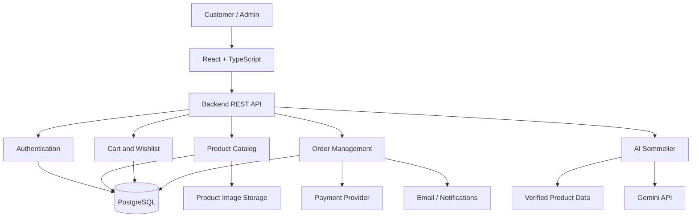

# 🍰 MITHRA SWEETS & BAKERY

### Premium Sweets. Artisan Cakes. Memorable Celebrations.

> **Tradition in Every Bite. Happiness in Every Celebration.**

<div align="center">


**A Modern Digital Storefront for Indian Sweets, Cakes, Bakery Products, and Personalized Gifts.**

[Live Demo](#) · [GitHub](https://github.com/Mugunthandk) · [LinkedIn](https://www.linkedin.com/in/mugunthandk/)

⭐ If you like this project, give the repository a star!

</div>

---

## 📖 1. Project Overview

**Mithra Sweets & Bakery** is a premium e-commerce web application concept that brings traditional Indian sweets, artisan cakes, fresh bakery products, beverages, and personalized gift hampers into a modern digital shopping experience.

The platform is designed to help customers discover products, explore categories, compare options, plan celebrations, and conveniently shop for everyday treats and special occasions.

Its long-term vision combines a visually rich storefront with full-stack commerce capabilities and an AI-powered product discovery assistant.

### 🎯 Core Objectives

- Create a premium and responsive online bakery storefront.
- Showcase products through attractive imagery and detailed descriptions.
- Simplify product discovery using search, filters, and categories.
- Support personalized cakes and celebration orders.
- Provide a convenient cart and checkout experience.
- Introduce AI-assisted product and gift recommendations.
- Build a foundation for inventory, payments, delivery, and administration.

---

## ✨ 2. Key Features

### 🛍️ Premium Product Discovery

- Categorized product collections.
- Product details and image galleries.
- Product variants, flavors, sizes, and quantities.
- Search and category filtering.
- Featured products and best sellers.
- Seasonal collections and festival specials.
- Product ratings and customer reviews.
- Related product recommendations.

### 🍬 Traditional Indian Sweets

Discover traditional and contemporary Indian sweet varieties.

- Kaju Katli
- Mysore Pak
- Laddu varieties
- Gulab Jamun
- Rasgulla
- Jangiri
- Halwa varieties
- Milk sweets
- Regional specialties
- Assorted mithai gift boxes

Product availability, ingredients, and prices should come from the actual store catalog.

### 🎂 Premium Cakes & Custom Celebrations

- Birthday cakes
- Wedding and anniversary cakes
- Chocolate and designer cakes
- Custom photo cakes
- Eggless cake options
- Flavor and size selection
- Personalized cake messages
- Celebration packages
- Scheduled delivery requests

**Planned enhancement:** A custom cake ordering workflow with delivery dates, serving sizes, reference images, and special instructions.

### 🥐 Bakery & Beverages

**Bakery collection**
- Bread and buns
- Cookies and biscuits
- Puffs and savory snacks
- Pastries and muffins
- Croissants and baked treats

**Beverage collection**
- Coffee and tea
- Traditional Indian drinks
- Seasonal beverages
- Milk-based drinks

### 🎁 Gifts & Festival Collections

- Premium sweet boxes
- Birthday hampers
- Wedding return gifts
- Corporate gifting
- Personalized gift messages
- Bulk gifting requests
- Diwali and Pongal collections
- Christmas and seasonal assortments

### 🛒 Smart Shopping Cart

- Add and remove products.
- Update quantities.
- Select product variants.
- Calculate order subtotals.
- Apply eligible coupons.
- Display delivery charges and taxes.
- Preserve cart state where supported.
- Validate current stock and pricing before checkout.

### 💳 Checkout & Payments

**Planned full-stack capabilities**

- Customer details and delivery addresses.
- Order summary and pricing breakdown.
- Delivery slot selection.
- Scheduled cake delivery.
- Coupon validation.
- Online payment integration.
- Cash on delivery where supported.
- Order confirmation and payment status.

Payment processing requires a configured provider and secure backend verification.

### 🚚 Order Management

- Customer order history.
- Order status timeline.
- Delivery instructions.
- Scheduled delivery requests.
- Cancellation according to business rules.
- Email or WhatsApp notifications.
- Delivery status updates.

Real-time delivery tracking requires an appropriate logistics integration.

---

## 🤖 3. AI Sommelier: Intelligent Product Discovery

The **AI Sommelier** is a planned AI-powered assistant that helps customers select sweets, cakes, and gifts based on their preferences, budgets, and occasions.

### Example use case

**Customer prompt:**

"Suggest a traditional Indian sweet gift box under ₹1,000 for a family celebration."

**Potential AI response:**

- Matching gift boxes from the product catalog.
- Current prices and package sizes.
- Available ingredients and verified allergen information.
- Recommendations based on the occasion.
- Direct links to product details.
- An option to add an available product to the cart.

### AI workflow

```text
          CUSTOMER PREFERENCES
                   |
                   v
         Budget + Occasion + Taste
                   |
                   v
          AI RECOMMENDATION API
                   |
                   v
         VERIFIED PRODUCT CATALOG
                   |
                   v
        FILTER AND RANK PRODUCTS
                   |
                   v
         PERSONALIZED SUGGESTIONS
                   |
                   v
          VIEW PRODUCT / ADD CART
```

### AI capabilities planned

- Personalized sweet recommendations.
- Gift selection based on budget.
- Occasion-aware product discovery.
- Cake flavor and size guidance.
- Gift hamper suggestions.
- Conversational shopping assistance.
- Recommendations grounded in actual product data.

AI must not invent prices, availability, ingredients, or allergy safety information. These details should be retrieved from verified catalog records.

---

## 🎨 4. UI/UX Design Philosophy

Mithra Sweets & Bakery is designed around an elegant, welcoming shopping experience that balances traditional Indian food culture with modern e-commerce design.

### Design principles

- Premium product-focused layouts.
- High-quality product photography.
- Warm, bakery-inspired visual styling.
- Clear typography and content hierarchy.
- Intuitive category navigation.
- Consistent spacing and reusable components.
- Responsive product cards and shopping controls.
- Accessible forms and readable contrast.
- Loading, empty, and error states.

### Responsive experience

| Device | Design approach |
|---|---|
| Desktop | Expanded product grids and detailed navigation |
| Tablet | Adaptive layouts and balanced spacing |
| Mobile | Touch-friendly controls and streamlined shopping |

---

## 🏗️ 5. System Architecture

The following is a proposed full-stack architecture for expanding the storefront into a production e-commerce application.



### Architecture layers

1. **Presentation layer:** Product pages, navigation, cart, checkout, and customer-facing interfaces.
2. **Application layer:** Authentication, business rules, pricing validation, order management, and AI orchestration.
3. **Data layer:** Product records, variants, inventory, customer profiles, and orders.
4. **Integration layer:** Payment providers, image storage, email services, and AI APIs.

The diagram describes the proposed architecture, not necessarily the current implementation.

---

## 🛠️ 6. Technology Stack

### Frontend

| Technology | Purpose |
|---|---|
| React | Component-based interface |
| TypeScript | Type-safe development |
| Vite | Development server and build tooling |
| Tailwind CSS | Responsive styling |
| Framer Motion | Optional UI animations |

### Proposed backend and integrations

| Technology | Purpose |
|---|---|
| Node.js | Server runtime |
| Express.js | Backend REST APIs |
| PostgreSQL | Persistent application data |
| Prisma | Database access and migrations |
| Gemini API | AI Sommelier |
| Cloudinary | Product image management |
| Razorpay | Payment processing |
| Resend | Transactional emails |
| Vercel | Frontend deployment |
| Render | Optional backend hosting |

Keep the existing stack separate from proposed technologies. Only list an integration as implemented after it has been configured and tested.

---

## 📂 7. Project Structure

Example frontend organization:

```text
mithra-sweets-bakery/
├── public/
│   ├── images/
│   └── favicon.svg
├── src/
│   ├── assets/
│   ├── components/
│   │   ├── common/
│   │   ├── layout/
│   │   ├── products/
│   │   ├── cart/
│   │   └── checkout/
│   ├── pages/
│   ├── hooks/
│   ├── context/
│   ├── services/
│   ├── types/
│   ├── data/
│   ├── utils/
│   ├── styles/
│   ├── App.tsx
│   └── main.tsx
├── tests/
├── package.json
├── vite.config.ts
└── README.md
```

### Proposed backend structure

```text
server/
├── src/
│   ├── config/
│   ├── middleware/
│   ├── controllers/
│   ├── routes/
│   ├── models/
│   ├── services/
│   ├── validators/
│   ├── utils/
│   ├── app.ts
│   └── server.ts
├── tests/
├── package.json
└── .env.example
```

Adapt the structure to match the actual repository.

---

## ⚙️ 8. Getting Started

### Prerequisites

- Node.js compatible with your Vite version.
- npm.
- Git.
- A code editor such as Visual Studio Code.

### Installation

Clone the repository:

```bash
git clone https://github.com/Mugunthandk/mithra-sweets-bakery.git
cd mithra-sweets-bakery
```

Install dependencies:

```bash
npm install
```

Start the development server:

```bash
npm run dev
```

Open the local URL printed by Vite, typically:

```text
http://localhost:5173
```

Create a production build:

```bash
npm run build
```

Preview the production build:

```bash
npm run preview
```

Use the actual repository URL and available npm scripts for your implementation.

---

## 🔐 9. Environment Configuration

For the proposed backend, use environment variables to configure private services.

Example `.env.example`:

```env
NODE_ENV=development
PORT=5000

DATABASE_URL=
SESSION_SECRET=

GEMINI_API_KEY=

CLOUDINARY_CLOUD_NAME=
CLOUDINARY_API_KEY=
CLOUDINARY_API_SECRET=

RAZORPAY_KEY_ID=
RAZORPAY_KEY_SECRET=

CLIENT_URL=http://localhost:5173
EMAIL_API_KEY=
```

These are placeholders, not working credentials.

**Security requirements**

- Never commit `.env` files.
- Never expose private API keys in browser code.
- Validate requests on the server.
- Use secure authentication and authorization.
- Verify payment signatures and webhook events.
- Recalculate prices and check inventory on the backend.
- Protect customer information and administrative routes.

---

## 🔌 10. Proposed API Endpoints

| Method | Endpoint | Purpose |
|---|---|---|
| GET | `/api/products` | List products |
| GET | `/api/products/:id` | Product details |
| GET | `/api/categories` | Product categories |
| POST | `/api/auth/register` | Customer registration |
| POST | `/api/auth/login` | Customer login |
| GET | `/api/cart` | Retrieve shopping cart |
| POST | `/api/cart/items` | Add a cart item |
| GET | `/api/wishlist` | Retrieve saved products |
| POST | `/api/orders` | Create an order |
| GET | `/api/orders` | Retrieve customer orders |
| POST | `/api/ai/recommendations` | Request AI recommendations |
| POST | `/api/payments/verify` | Verify a payment |
| GET | `/api/admin/analytics` | Authorized business analytics |

These endpoints describe a proposed API contract. They should not be treated as live endpoints until implemented.

---

## 🗄️ 11. Database Design

A production version may use PostgreSQL to manage:

| Entity | Responsibility |
|---|---|
| Users | Customer and administrator accounts |
| Products | Sweets, cakes, bakery products, and gifts |
| Categories | Product classification |
| Product Variants | Size, flavor, weight, and packaging |
| Inventory | Stock quantities and updates |
| Carts | Shopping cart state |
| Cart Items | Selected products and quantities |
| Wishlists | Saved products |
| Orders | Customer purchases and order status |
| Order Items | Purchased items and price snapshots |
| Payments | Payment references and verified status |
| Coupons | Discount rules |
| Reviews | Product ratings |
| Cake Requests | Custom cake requirements |
| Delivery Slots | Available delivery windows |

Food-related information, including ingredients, allergens, shelf life, and storage instructions, should be maintained using verified business data.

---

## 🧪 12. Testing & Quality Assurance

### Recommended testing tools

- **Vitest:** Unit tests.
- **React Testing Library:** UI component tests.
- **Playwright:** Browser-based end-to-end tests.

### Testing checklist

- [ ] Product search and filtering.
- [ ] Product variant selection.
- [ ] Cart quantity updates.
- [ ] Coupon validation.
- [ ] Delivery form validation.
- [ ] Custom cake request submission.
- [ ] Inventory validation.
- [ ] Payment success and failure handling.
- [ ] Duplicate order prevention.
- [ ] Administrator access controls.
- [ ] Responsive layouts.
- [ ] Accessibility checks.

Run test commands only after the relevant testing scripts and dependencies have been configured.

---

## 🚀 13. Deployment

### Frontend deployment with Vercel

1. Push the project to GitHub.
2. Import the repository into Vercel.
3. Configure the project root directory.
4. Set the build command to `npm run build`.
5. Set the output directory to `dist` for a standard Vite application.
6. Configure required environment variables.
7. Deploy and test the production URL.

### Optional backend deployment with Render

1. Create a backend web service.
2. Configure build and start commands.
3. Add server-side environment variables.
4. Connect the database securely.
5. Configure trusted frontend origins.
6. Test API responses and error handling.
7. Verify payment processing before production use.

---

## 🔮 14. Development Roadmap

Features below are planned enhancements unless already implemented and verified.

### Phase 1: Storefront

